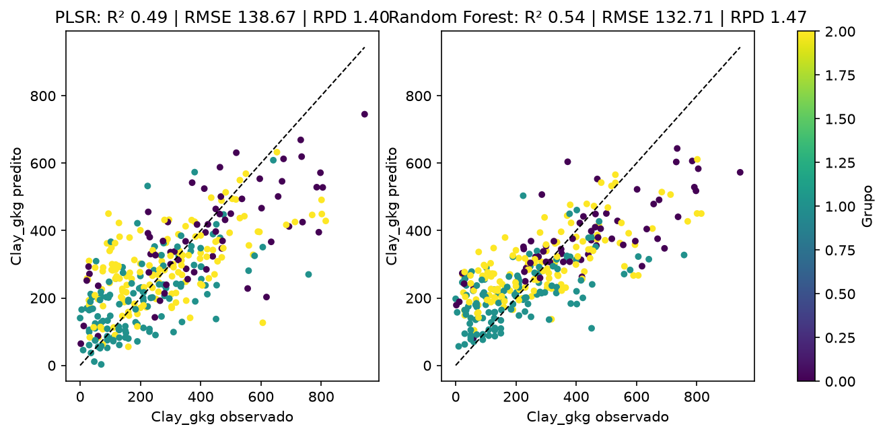

Pipeline que lê o banco espectral Saturin, trata os espectros, explora a variação com PCA e
k-means e ajusta modelos PLSR e Random Forest para estimar o teor de argila (`Clay_gkg`), com
verificação do domínio de aplicação por T² e Q.

::: {.kpis}

<b>1125</b>amostras modeladas

<b>2001</b>bandas (450–2450 nm)

<b>0,54</b>R² validação · Random Forest

<b>0,49</b>R² validação · PLSR

:::

## Etapas

Execute os notebooks em ordem. Cada um lê o que o anterior salvou em `resultados/`.

| | Notebook | O que faz | Destaque |
|:--|:--|:--|:--|
| 01 | [Leitura e exploração](01_leitura_exploratoria.ipynb) | Leitura, estatística descritiva, limpeza e correlação por banda | 5000 → 1150 amostras; maior \|r\| 0,47 em 2206 nm |
| 02 | [Pré-processamento e outliers](02_preprocessamento.ipynb) | Corte, absorbância, Savitzky-Golay, 1ª derivada, SNV, z-score, T² e Q | 2151 → 2001 bandas; 25 outliers removidos |
| 03 | [PCA e clusterização](03_pca_clusterizacao.ipynb) | PCA, cotovelo, silhueta e k-means | PC1 63,7%; 5 PCs 95,0%; k = 3 |
| 04 | [Modelagem](04_modelagem.ipynb) | PLSR com tratamento e nº de VLs por validação cruzada; Random Forest | 787 calibração / 338 validação; sg com 17 VLs |
| 05 | [Visualização e predição](05_visualizacao_predicao.ipynb) | Observado × predito, resíduos, VIP, importância e amostras novas | Sem amostras novas configuradas |

## Resultado principal



Na validação independente os dois modelos ficam próximos (R² ≈ 0,49–0,54, RPD ≈ 1,4–1,5).
O R² de 0,94 do Random Forest na calibração, contra 0,54 na validação, indica sobreajuste.
Veja todas as figuras em [Resultados](resultados.qmd).

{fig-align="center"}
