Alvo: argila (g/kg). Amostra aleatória de 5000 linhas do arquivo NIR (SEED = 42).
Arquivos: [metricas.csv](resultados/metricas.csv){download="metricas.csv"} ·
[predicoes_validacao.csv](resultados/predicoes_validacao.csv){download="predicoes_validacao.csv"}

## Métricas



## 01 · Leitura e exploração

::: {layout-ncol=3}
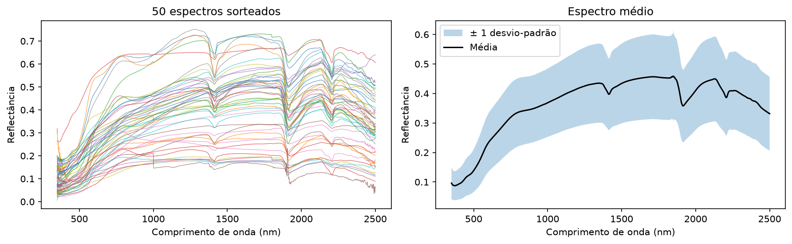{group="g01"}

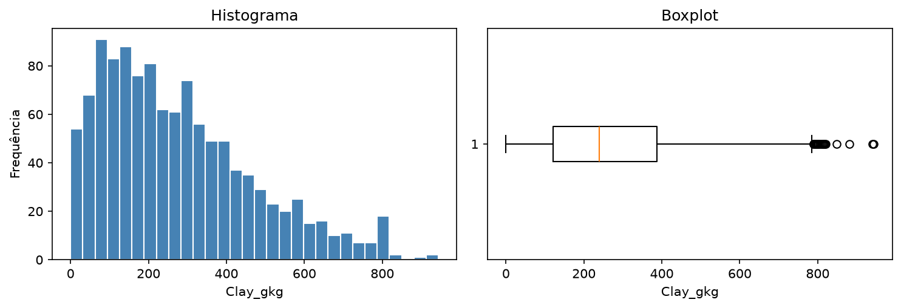{group="g01"}

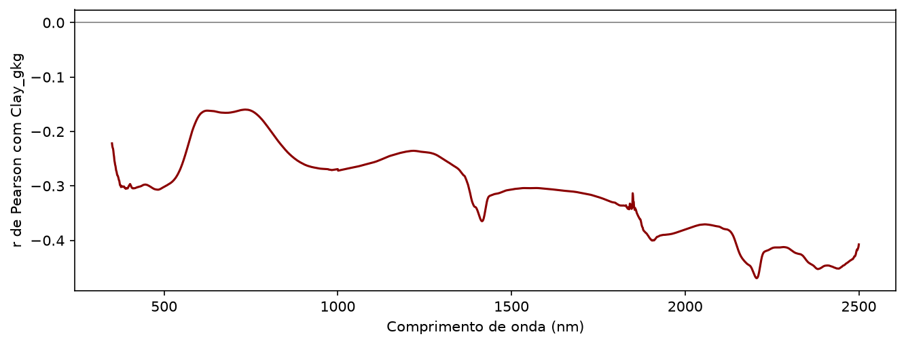{group="g01"}
:::

## 02 · Pré-processamento e outliers

::: {layout-ncol=2}
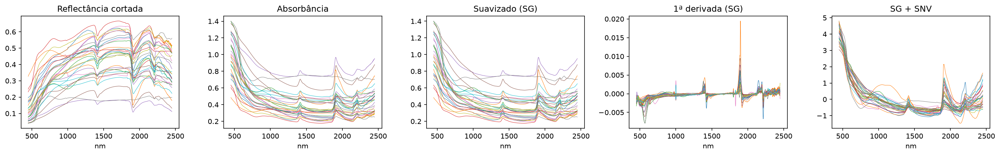{group="g02"}

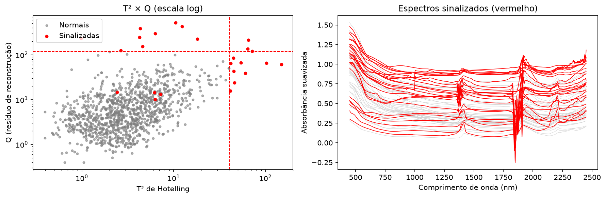{group="g02"}
:::

## 03 · PCA e clusterização

::: {layout-ncol=2}
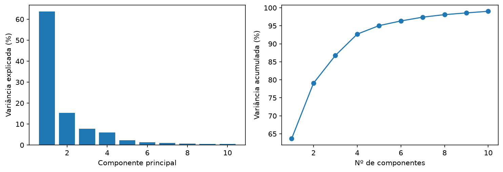{group="g03"}

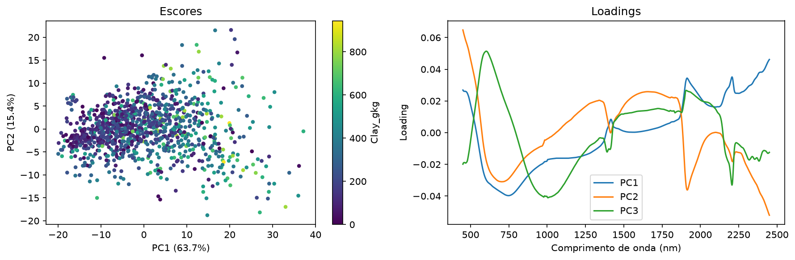{group="g03"}

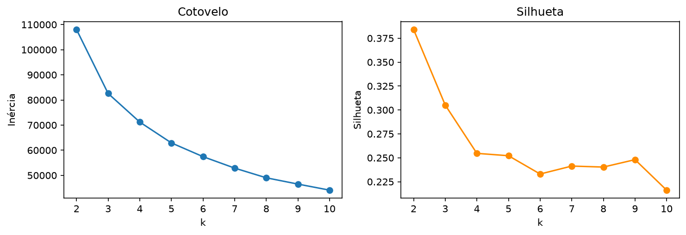{group="g03"}

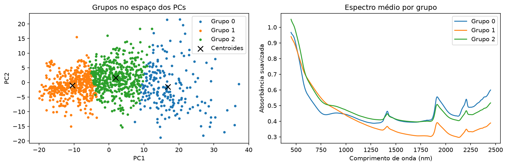{group="g03"}
:::

## 04 · Modelagem

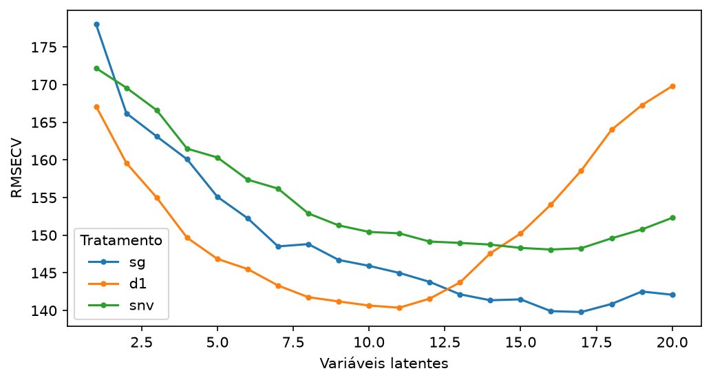

## 05 · Visualização e interpretação

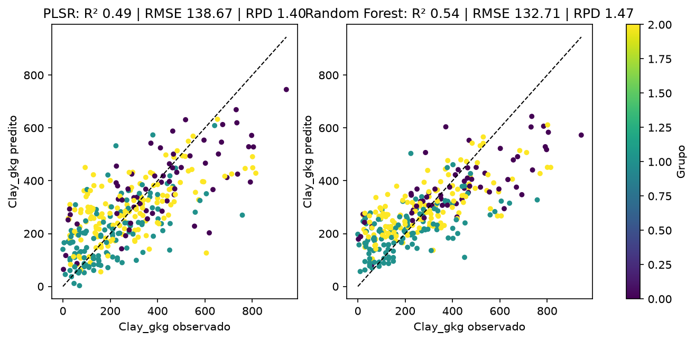{group="g05"}

::: {layout-ncol=2}
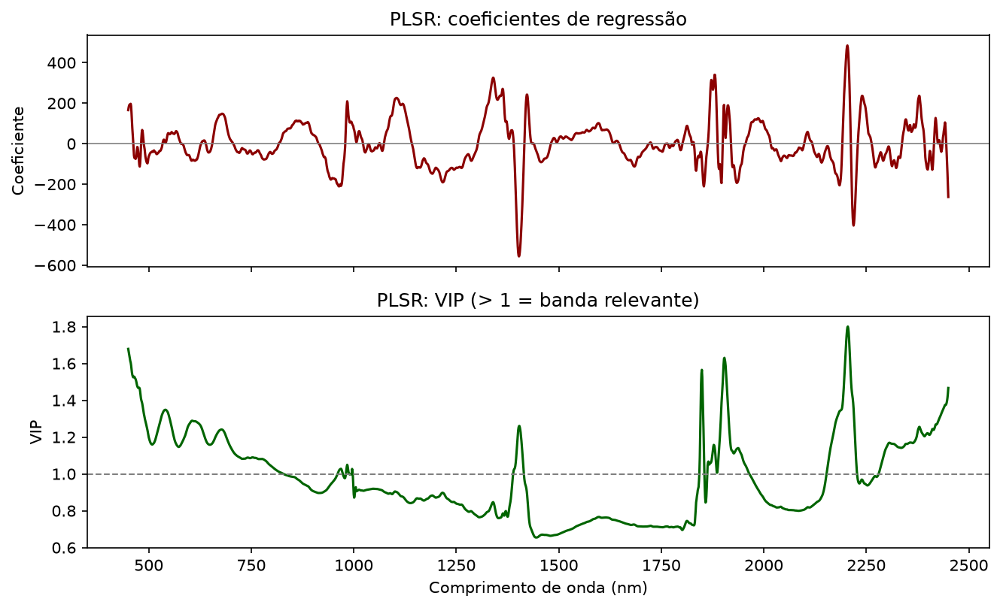{group="g05"}

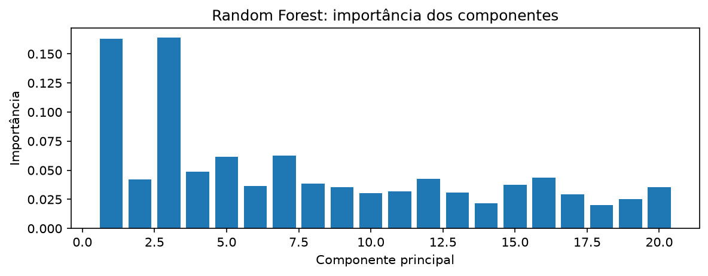{group="g05"}
:::
